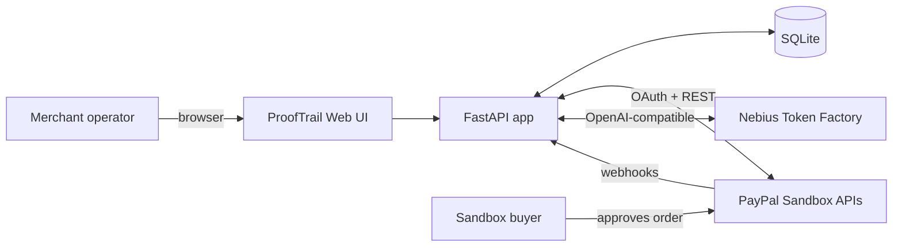
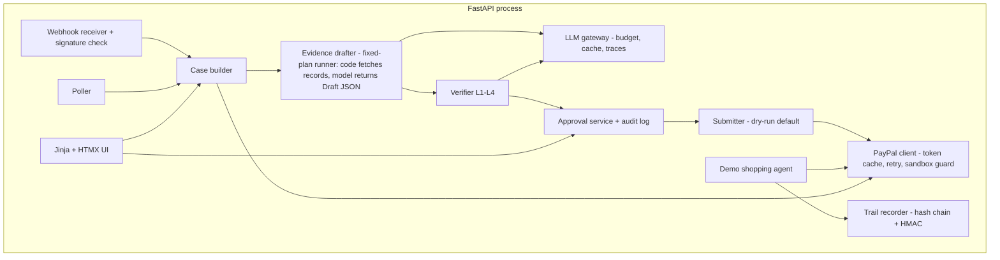
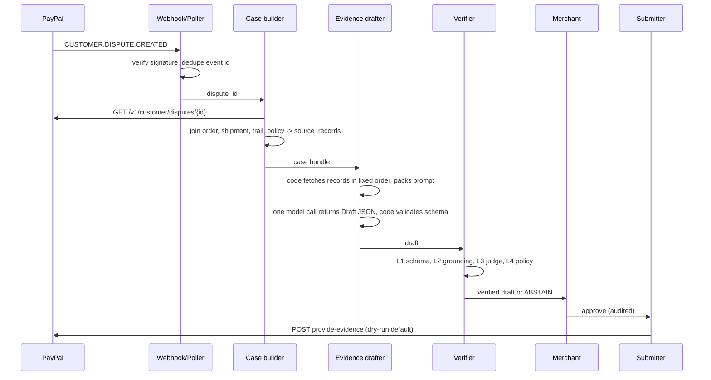
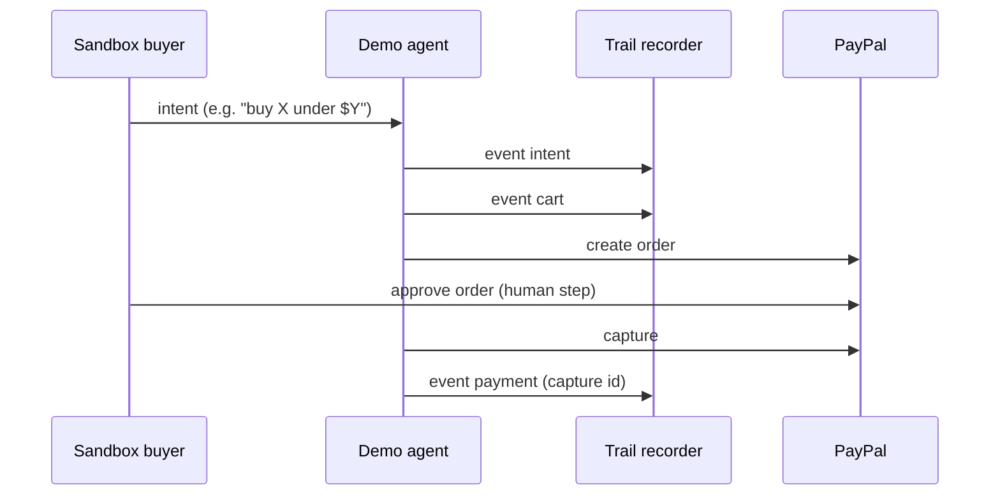

# 03 — Architecture


## 1. Principles
1. **Agent proposes, verifier checks, human decides, only code submits.**
2. The model has **no tools and no write access**. Application code fetches records (read-only) and calls the model once to produce a `Draft` JSON. The model cannot call any endpoint.
3. Every external call and LLM call is logged and replayable.
4. Untrusted text (buyer messages, notes) is data, never instructions.
5. One command to run, one command to eval.

## 2. System context


## 3. Components


## 4. Core flow: dispute to submission


## 5. Trail flow (agent purchase)


## 6. Modes
| Mode | PayPal | LLM | Purpose |
|---|---|---|---|
| `live-sandbox` | sandbox APIs | Nebius | Real demo |
| `replay` | recorded fixtures | cached responses | Judges without keys. UI shows REPLAY badge |
| `eval` | fixtures | Nebius, budget-guarded | Measurement |

## 7. Directory layout
```
proof-trail/
  app/ (main.py, routes/, templates/, static/)
  core/ (paypal_client.py, trail.py, case_builder.py, agent.py, verifier.py, submitter.py, gateway.py)
  data/ (fixtures/, replay/)
  eval/ (cases/, run.py, metrics.py, report.py)
  docs/  tests/  .env.example  Makefile  LICENSE  README.md
```

## 8. Technology choices and why
| Choice | Reason | Rejected |
|---|---|---|
| FastAPI | typed, async, quick | Django (heavy) |
| SQLite | zero setup, file is the demo state | Postgres |
| HTMX + Jinja | no build step, one language | React (build + time) |
| OpenAI SDK → Nebius | provider swap is a base URL | custom client |
| Own eval harness | full control, JSONL traces | heavy frameworks |

## 9. Failure behavior
| Failure | Behavior |
|---|---|
| LLM timeout / invalid JSON | retry once, then mark run FAILED, show in UI |
| PayPal 429/5xx | exponential backoff, max 3 |
| Webhook down | poller catches up |
| Verifier judge unavailable | **fail closed**: claims become Needs review |
| Budget cap hit | block LLM calls, UI shows banner |

## 10. Observability
JSONL trace per run (prompt hash, model, tokens, cost, latency, record ids fetched, schema-validation result). UI shows the run trace link.
