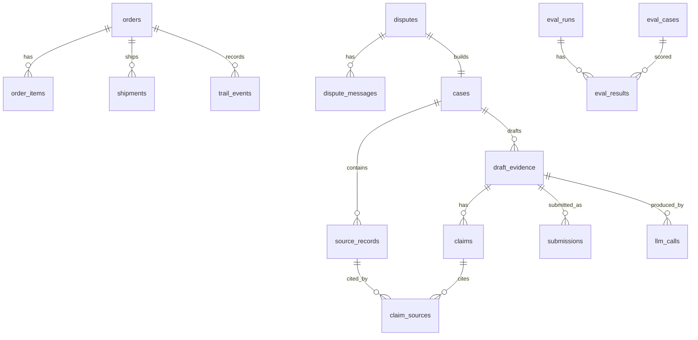

# 04 — Data Model


## 1. ER overview


## 2. Tables
Types: TEXT, INTEGER, REAL. Money stored as **integer minor units** plus currency code. Timestamps ISO-8601 UTC TEXT.

| Table | Key columns |
|---|---|
| `orders` | `id` PK, `paypal_order_id`, `capture_id`, `buyer_ref`, `amount_minor`, `currency`, `status`, `created_at`, `origin` (`human`/`agent`) |
| `order_items` | `id`, `order_id` FK, `sku`, `name`, `qty`, `unit_minor` |
| `shipments` | `id`, `order_id` FK, `carrier`, `tracking_number`, `shipped_at`, `delivered_at`, `delivery_status` |
| `trail_events` | `id`, `order_id`, `seq`, `kind` (`intent`/`cart`/`payment`), `payload_json`, `prev_hash`, `hash`, `hmac`, `created_at` |
| `policies` | `id`, `version`, `text`, `effective_from` |
| `disputes` | `id`, `paypal_dispute_id` UNIQUE, `reason`, `status`, `stage`, `amount_minor`, `currency`, `due_at` (nullable), `raw_json`, `created_at`, `updated_at`, `origin` (`sandbox`/`fixture`) |
| `dispute_messages` | `id`, `dispute_id`, `author_role`, `text`, `untrusted` (always 1) |
| `webhook_events` | `event_id` PK, `type`, `received_at`, `verified` |
| `cases` | `id`, `dispute_id`, `built_at`, `bundle_hash` |
| `source_records` | `record_id` PK (e.g. `ord:123`, `shp:9`, `trl:5`, `pol:2`, `msg:4`, `dsp:77`), `case_id`, `kind`, `content_json`, `untrusted` |
| `draft_evidence` | `id`, `case_id`, `run_id`, `decision` (`CONTEST`/`ACCEPT`/`ABSTAIN`), `rationale`, `status` (`DRAFT`/`VERIFIED`/`APPROVED`/`SUBMITTED`/`FAILED`), `created_at` |
| `claims` | `id`, `draft_id`, `text`, `type`, `confidence`, `verdict` (`VERIFIED`/`NEEDS_REVIEW`/`REMOVED`), `verdict_reason` |
| `claim_sources` | `claim_id`, `record_id`, `field`, `quoted_value` |
| `submissions` | `id`, `draft_id`, `mode` (`dry_run`/`sandbox`), `payload_hash`, `response_json`, `submitted_at` |
| `approvals` | `id`, `draft_id`, `actor`, `decision`, `note`, `payload_hash`, `at` |
| `audit_log` | `id`, `actor`, `action`, `entity`, `entity_id`, `detail_json`, `at` (append-only) |
| `llm_calls` | `id`, `run_id`, `model`, `role` (`agent`/`judge`/`baseline`), `prompt_hash`, `in_tokens`, `out_tokens`, `cost_usd`, `latency_ms`, `cached`, `at` |
| `eval_cases` | `id`, `split` (`dev`/`test`), `category`, `spec_json`, `ground_truth_json`, `seed` |
| `eval_runs` | `id`, `system` (`baseline`/`verified`), `model`, `repeat`, `started_at`, `config_hash` |
| `eval_results` | `run_id`, `case_id`, `metrics_json`, `trace_path` |

## 3. Invariants (enforced in code and tests)
1. Every `claims` row has at least one `claim_sources` row **or** verdict is REMOVED.
2. `claim_sources.record_id` must exist in `source_records` for the same case.
3. `trail_events.hash = SHA256(prev_hash || canonical_json(payload) || seq || kind)`; `hmac = HMAC_SHA256(TRAIL_KEY, hash)`.
4. `audit_log` has no UPDATE or DELETE paths.
5. `source_records.untrusted = 1` for buyer-authored text; the prompt wraps it in a delimited block.
6. `llm_calls.cost_usd` is computed from a price table in config, not from model output.

## 4. Case bundle JSON (given to the agent)
```json
{
  "case_id": "c_001",
  "dispute": {"record_id": "dsp:77", "reason": "MERCHANDISE_OR_SERVICE_NOT_RECEIVED", "amount": "49.00 USD"},
  "records": [
    {"record_id": "ord:123", "kind": "order", "untrusted": false, "content": {}},
    {"record_id": "shp:9",  "kind": "shipment", "untrusted": false, "content": {}},
    {"record_id": "trl:5",  "kind": "trail_event", "untrusted": false, "content": {}},
    {"record_id": "msg:4",  "kind": "buyer_message", "untrusted": true,  "content": {"text": "..."}}
  ],
  "required_evidence": ["PROOF_OF_FULFILLMENT"]
}
```
`required_evidence` values are **[VERIFY]** against the real `evidence_type` enum.

## 5. Retention and PII
Synthetic data only in the repo. Sandbox buyer emails are sandbox-generated. Logs redact tokens and emails. `make reset` wipes the DB.
