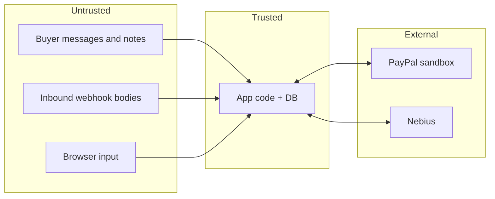

# 08 — Security and Threat Model

## 1. Assets
PayPal client secret; webhook ID; Nebius API key; trail HMAC key; sandbox order and dispute data; LLM budget; repo reputation.

## 2. Trust boundaries

## 3. Threat table (STRIDE-flavored)
| ID | Threat | Impact | Mitigation | Test |
|---|---|---|---|---|
| T1 | Secret leak (repo, logs, chat, video) | Account abuse | `.env` gitignored; `.env.example` only; log redaction; secret scan (gitleaks) pre-commit and CI; rotate if ever exposed; never show Settings values on camera | scan passes; grep for key patterns |
| T2 | Prompt injection via buyer message/notes | Corrupt draft | delimit + label untrusted; model has no tools or write access; verifier caps untrusted-only claims; human gate | 8 injection eval cases |
| T3 | Fabricated evidence submitted | Merchant harm, bad-faith filing | citation requirement, verifier, abstain, approval, payload preview | eval fabrication rate |
| T4 | Webhook spoofing | Fake disputes | verify signature via PayPal endpoint; reject on failure | tampered-body test |
| T5 | Webhook replay / duplicates | Double processing | dedupe on `event_id` | double-delivery test |
| T6 | Excessive agency | Unwanted submission | model has no tools and no write access; submit only via approved route; dry-run default | route test 403 |
| T7 | Cost runaway (loop, attacker) | Burn credits | budget guard, `max_tokens`, cache, per-run call cap, hard stop $20 | simulated spend test |
| T8 | PII exposure | Privacy | synthetic/sandbox data only; redact emails in logs | log scan |
| T9 | XSS (rendering buyer text) | Session abuse | Jinja autoescape on, no `|safe` on untrusted, CSP header | injected `<script>` fixture |
| T10 | SQL injection | Data loss | parameterized queries only | lint rule + test |
| T11 | CSRF on approve/submit | Forced submit | CSRF token, SameSite=Strict cookie, POST only | missing-token test |
| T12 | Trail tampering | False proof | hash chain + HMAC; described as **tamper-evident, not tamper-proof** (key holder can forge) | edit-row test |
| T13 | Supply chain | Malicious dep | pinned versions, lockfile, minimal deps, no CDN scripts beyond Tailwind/HTMX with SRI where possible | `pip-audit` |
| T14 | Pointing at live PayPal | Real-money harm | base URL allowlist = sandbox host only; startup fails otherwise | unit test |
| T15 | Unauthorized UI access if hosted | Data exposure | localhost by default; if hosted, HTTP basic auth + replay mode only | manual check |
| T16 | SSRF via tunnel/webhook config | Internal access | no user-supplied URLs fetched | code review |

## 4. Secrets handling rules
1. Keys live only in `~/proof-trail/.env`. Never pasted into chat, issues, README or video.
2. `.gitignore` includes `.env`, `.venv/`, `*.db`, `eval/out/` (except published reports).
3. `.env.example` has placeholders only.
4. If a secret is exposed anywhere: rotate immediately, then continue.

## 5. Rule-compliance checklist (submission)
- [ ] Visible open-source LICENSE file shown in repo About
- [ ] Public repo, README with run steps and replay mode
- [ ] Video under 3:00, shows project working, English
- [ ] No PayPal or other third-party logos/trademarks in video or UI
- [ ] No copyrighted music (use none)
- [ ] PayPal sandbox APIs clearly used (list them in text description)
- [ ] No secrets in repo history
- [ ] No claims of "first", "only", "proof", compliance, or win-rate
- [ ] Limits section present

## 6. Responsible-use statement (README)
ProofTrail drafts and verifies evidence from records the merchant already holds. It does not generate or alter records, never submits without a human decision, and must not be used to file evidence the merchant knows to be false.

## 7. Incident plan (solo)
Leak → rotate key → purge history if committed → note in changelog. Budget breach → stop run, inspect `llm_calls`.
